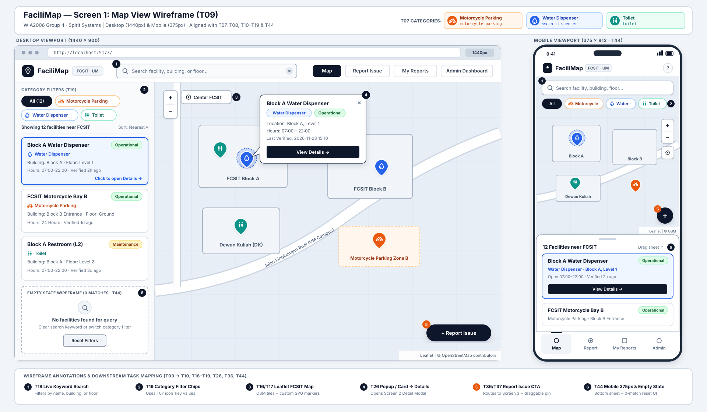
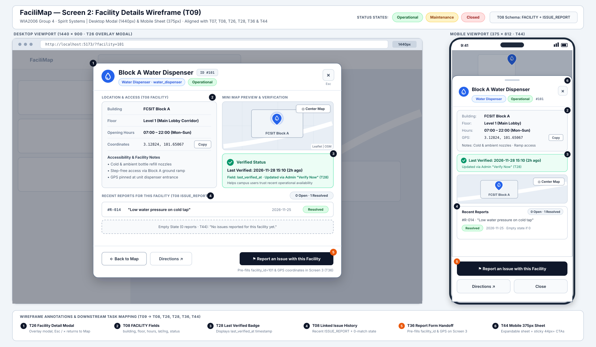
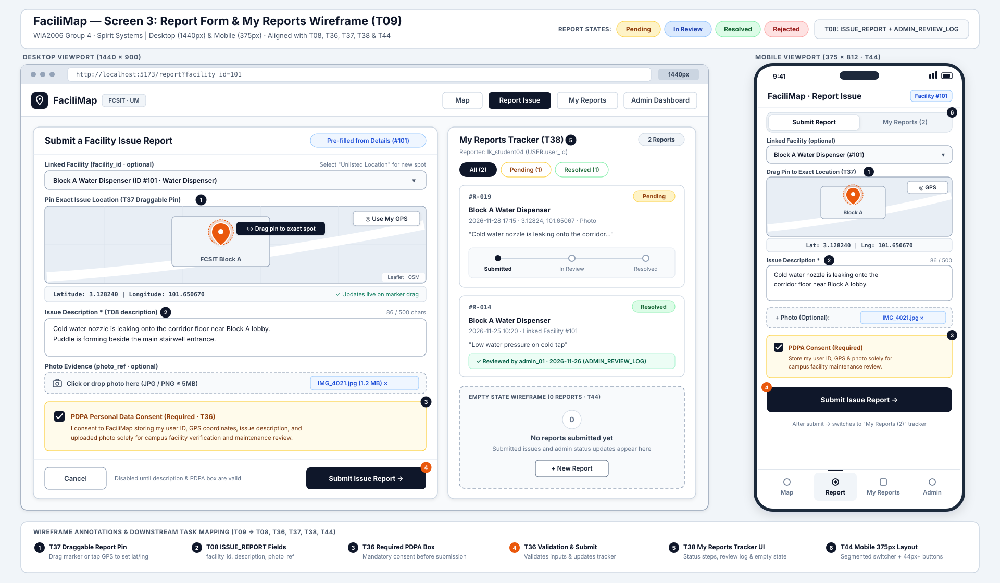
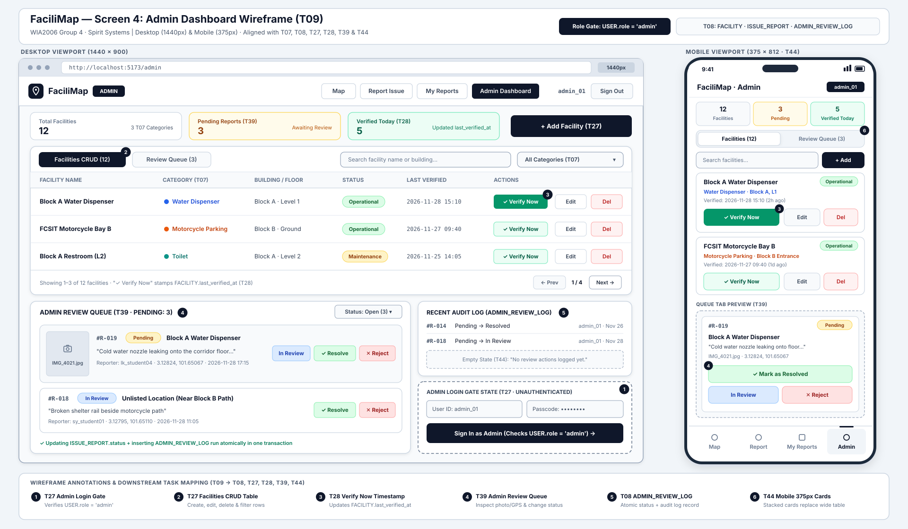

# FaciliMap 4-Screen Wireframes (T09)

- **Project:** FaciliMap (`WIA2006 Group 4 · Spirit Systems, OCC 3`)
- **Task:** `T09 — 4-Screen Wireframes` (Tier 1 · Setup)
- **Owner:** Li Kaichen (LK · UI/UX & Frontend Leaflet)
- **Prerequisite:** `T02` (Folder Structure & `.gitignore`)
- **Unlocks:** `T10` (Frontend & Leaflet Base) and downstream UI tasks `T16`–`T19`, `T26`–`T28`, `T36`–`T39`, `T44`

---

## 1. Overview & Responsive Targets

Each of the 4 core FaciliMap screens includes both a **Desktop (`1440 × 900`)** wireframe and a **Mobile (`375 × 812`)** wireframe aligned with `docs/facility-categories.md` (T07) and `docs/master-data-dictionary.md` (T08).

| Screen | Wireframe File | Desktop Layout | Mobile Layout (`375px` · T44) | Downstream Tasks |
|---|---|---|---|---|
| **1. Map View** | [`01-map-wireframe.svg`](./wireframes/01-map-wireframe.svg) | Navbar + Search + Filter Sidebar + Leaflet Map & Popup | Full-screen Map + Floating Search/Chips + Draggable Bottom Sheet + Bottom Tab Bar | `T10`, `T16`–`T19`, `T26`, `T36`, `T44` |
| **2. Facility Details** | [`02-details-wireframe.svg`](./wireframes/02-details-wireframe.svg) | Centered Overlay Modal (Metadata + Mini Map + Verification + History) | Map Context Peek + Expandable Sheet + Sticky `44px+` Footer | `T26`, `T28`, `T36`, `T44` |
| **3. Report Form & My Reports** | [`03-report-wireframe.svg`](./wireframes/03-report-wireframe.svg) | Split View: Report Form (`T36`/`T37`) + My Reports Tracker (`T38`) | Segmented `[Submit Report \| My Reports]` Switcher + Single-Column Form | `T36`, `T37`, `T38`, `T44` |
| **4. Admin Dashboard** | [`04-admin-wireframe.svg`](./wireframes/04-admin-wireframe.svg) | KPI Strip + Facilities CRUD Table + Review Queue + Audit Log & Login Gate | Compact KPIs + Segmented `[Facilities \| Queue]` + Stacked Action Cards | `T27`, `T28`, `T39`, `T44` |

---

## 2. Screen Wireframes

### Screen 1: Map View

- **Search & Filter (`T18`, `T19`)**: Live keyword search across `FACILITY.name`, `building`, and `floor`; category chips mapped directly to T07 `icon_key` values.
- **FCSIT Leaflet Map (`T10`, `T16`, `T17`)**: OpenStreetMap tiles with zoom controls, `Center FCSIT` button, custom SVG pins, and marker popup linking to Screen 2 (`View Details →`).
- **Empty State (`T44`)**: 0-match query fallback with `[Reset Filters]` action.

### Screen 2: Facility Details

- **Overlay Modal (`T26`)**: Displays `facility_id`, category pill, status pill (`Operational` / `Maintenance` / `Closed`), full `FACILITY` fields (`building`, `floor`, `opening_hours`, `latitude`, `longitude`), mini map preview, and linked `ISSUE_REPORT` summary.
- **Verification Freshness (`T28`)**: Dedicated badge displaying `FACILITY.last_verified_at` updated by the admin `Verify Now` action.
- **Report Handoff (`T36`)**: `[Report an Issue with this Facility]` pre-fills `facility_id` and coordinates in Screen 3.

### Screen 3: Report Form & My Reports

- **Draggable Pin (`T37`)**: Interactive Leaflet marker + `[Use My GPS]` control updating `latitude` and `longitude` live.
- **PDPA Consent & Validation (`T36`)**: Mandatory PDPA checkbox plus required `description` and optional `photo_ref` upload (`JPG`/`PNG ≤ 5MB`); submit button stays disabled until required fields are valid.
- **My Reports Tracker (`T38`)**: Filterable cards (`All` / `Pending` / `Resolved`), 3-step status progress (`Submitted → In Review → Resolved`), `ADMIN_REVIEW_LOG` attribution, and 0-report empty state.

### Screen 4: Admin Dashboard

- **Admin Auth Gate (`T27`)**: Role-gated access verifying `USER.role = 'admin'`.
- **Facilities CRUD & Verify Now (`T27`, `T28`)**: Searchable/filterable table (stacked cards on 375px mobile) with one-click `✓ Verify Now` stamping `FACILITY.last_verified_at`.
- **Review Queue & Audit Log (`T39`, `T08`)**: Photo/GPS inspection and status transitions (`In Review`, `Resolved`, `Rejected`) paired atomically with `ADMIN_REVIEW_LOG` entries.

---

## 3. T07 Facility Categories & T08 Schema Traceability

### T07 Category Mapping (`docs/facility-categories.md`)

| Category Label | `icon_key` | Marker Symbol | Wireframe Accent |
|---|---|---|---|
| `Motorcycle Parking` | `motorcycle_parking` | Motorcycle | `#EA580C` (Orange) |
| `Water Dispenser` | `water_dispenser` | Water droplet | `#2563EB` (Blue) |
| `Toilet` | `toilet` | Restroom sign | `#0D9488` (Teal) |

### T08 Data Dictionary Field Coverage (`docs/master-data-dictionary.md`)

| Table | Fields | Primary Screen(s) |
|---|---|---|
| `CATEGORY` | `category_id`, `name`, `icon_key` | Screen 1 (Chips/Pins), Screen 2 (Badge), Screen 4 (Filter/Table) |
| `FACILITY` | `facility_id`, `category_id`, `name`, `building`, `floor`, `latitude`, `longitude`, `opening_hours`, `status`, `last_verified_at` | Screen 1 (Cards/Popup), Screen 2 (Full Detail), Screen 3 (Linked Select), Screen 4 (CRUD & Verify Now) |
| `ISSUE_REPORT` | `report_id`, `reporter_user_id`, `facility_id`, `description`, `latitude`, `longitude`, `photo_ref`, `status`, `created_at` | Screen 2 (Linked History), Screen 3 (Form & Tracker), Screen 4 (Review Queue) |
| `ADMIN_REVIEW_LOG` | `review_id`, `report_id`, `admin_user_id`, `previous_status`, `new_status`, `reviewed_at` | Screen 3 (Resolved Note), Screen 4 (Audit Log) |
| `USER` | `user_id`, `role` | Screen 3 (Reporter ID), Screen 4 (Admin Role Gate) |

---

## 4. Responsive & QA Checklist (`T10` & `T44` Handoff)

- **Breakpoints**: Desktop split/modal layouts designed for `1440px` (`≥1024px`); mobile layouts verified for `375px` single-column / bottom-sheet viewports with zero horizontal overflow.
- **Touch Targets**: All mobile navigation tabs, bottom sheet CTAs, form submit buttons, and admin card actions meet `≥44px` minimum target height.
- **Empty States**: Defined explicitly across Screen 1 (0 search/filter matches), Screen 2 (0 linked reports), Screen 3 (0 submitted reports), and Screen 4 (0 audit log entries).
- **Attribution & Compliance**: Leaflet + OpenStreetMap attribution preserved on all map surfaces; mandatory PDPA consent box enforced before `ISSUE_REPORT` submission.
